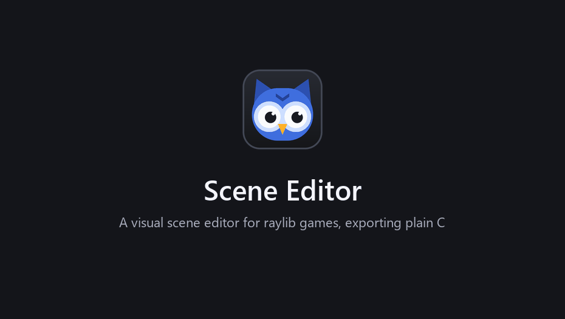

#  Scene Editor

_Yep, this is vibecoded software: the editor itself is AI-generated code. The code it
generates for your game, though, comes from a fixed set of rules applied to the layouts
you edit in the editor._

A visual scene editor for [raylib](https://www.raylib.com/) games. Block out your levels
and UI visually instead of working out positions by hand, then export them as plain C11
code for your game. Every entity and UI element becomes a named field of a C struct, so
your game can read its position and scale and draw your own things there.

## Why it's useful

When working with game libraries like raylib, I often found myself positioning UI elements
with length calculations and lots of temporary variables. Even then, the layout didn't
scale well, because my calculations assumed one reference screen size and players'
screens differ. This is my attempt to automate most of that maths in a way that scales
well, while staying out of the main game code.



## What it does

- **Level layout:** entities with transforms and parents, sprites (rectangle, circle,
  triangle) as placeholders, and colliders (box, circle, triangle). The exported code gives
  you each entity's final `pose` and its collider, ready for your own drawing or level
  generation.
- **UI that fits any screen:** UI elements anchored to the screen's corners, edges or
  centre, or stretched along them, and linear layouts that line up toolbars and menus.
  Preview other screen shapes (16:10, 21:9, 4:3,
  portrait...) right in the editor. In the game, each element has a `rect` in window
  pixels to draw your own widgets into.
- **Scaling:** design for one resolution; the game fits it to any window with the scale
  mode you pick (Expand, Fit or Fill).
- **Physics (optional):** rigidbodies and colliders become [Box2D](https://box2d.org/)
  bodies.
- **Platformer controller:** a component that makes a body a playable character: run,
  jump, coyote time, jump buffering and variable jump height, tuned in the editor.
- **Play:** export, build and run the game from the editor (F5).


The screenshots are of the sample project in [tests/SampleProject](tests/SampleProject).

## What it doesn't do

It isn't a game engine like Godot or Unity, where you can build your entire game inside the
editor with some scripting, and it has none of their advanced features. It's meant for
blocking out your scenes visually; your game then uses the exported C code to draw your
entities.

## The exported game

This is what a minimal `main()` looks like with the generated code. The exported
`project_main.c` also lets you switch scenes with Tab and Shift+Tab.

**With the SceneManager**, which holds all your scenes and switches between them:

```c
#include "scene_manager.h"

int main(void) {
    static SceneManager scenes;
    InitWindow(1280, 720, "My game");
    scene_manager_init(&scenes, SCENE_ID_LEVEL);
    while (!WindowShouldClose()) {
        scene_manager_update(&scenes, GetFrameTime());
        BeginDrawing();
        ClearBackground(BLACK);
        scene_begin();
        scene_manager_draw(&scenes);
        DrawCircleV(scenes.level.coin.pose.position, 12.0f, GOLD); /* your own drawing, in scene coordinates */
        scene_end();
        scene_manager_draw_ui(&scenes);
        EndDrawing();
    }
    scene_manager_deinit(&scenes);
    CloseWindow();
}
```

**With a single scene**, here one called `level` (it has `step` and `deinit` only when it
has physics bodies, and `draw_ui` only when it has UI elements):

```c
#include "level.h"

int main(void) {
    static LevelScene level;
    InitWindow(1280, 720, "My game");
    scene_level_init(&level);
    while (!WindowShouldClose()) {
        scene_level_step(&level, GetFrameTime());
        BeginDrawing();
        ClearBackground(BLACK);
        scene_begin();
        scene_level_draw(&level);
        scene_end();
        scene_level_draw_ui(&level);
        EndDrawing();
    }
    scene_level_deinit(&level);
    CloseWindow();
}
```

Using the SceneManager, or a scene's `scene_<name>_draw()`, is optional. You can call
`scene_<name>_update_poses()` (and `scene_<name>_step()` for physics) to update the
entity positions, and draw your own entities with them.

The guides in [docs/](docs/README.md) cover the exported code: scenes, entities, UI,
scaling, physics and the full API.

The exported game is a complete raylib program, mainly so that the **Play** button can run a
preview. You can make your own changes inside the export folder: the export options in
Project Settings stop the editor from overwriting the Makefile, `project_main.c`, the VS Code
settings and `.gitignore` (the generated scene files are always replaced). But I suggest
keeping your game's code *outside* the export folder, so you can be sure the editor never
overwrites it. That also fits what this program is for: it's meant to be a helper, not the
main program, which is one of the reasons its feature set is limited.

## Drawing your own things

The editor does the placement maths; your game does the drawing. Each entity and UI
element you named in the editor is a field of its scene, holding where it ended up.

The world and the UI scale differently, so they're updated separately. Each frame, these
update a scene, in this order:

| Function | Updates |
|---|---|
| `scene_<name>_step(s, dt)` | physics: moves the bodies and writes them back to the entities' transforms |
| `scene_<name>_update_poses(s)` | every entity's `pose`, from the transforms |
| `scene_<name>_update_ui(s)` | every UI element's `rect`, and the scene's `ui_scale`, for the window size |

- **Drawing the world:** call `step`, then `scene_<name>_draw(s)`, which updates the poses
  itself.
- **Drawing the UI:** call `scene_<name>_draw_ui(s)`, which updates the UI itself.
- **Only updating** (you draw everything yourself): call `step`, `update_poses` and
  `update_ui`.

**In the world** (between `scene_begin` and `scene_end`), use an entity's `pose` for its
current transform, or `scene_box()` for the box of its collider:

```c
const ScenePose p = scenes.level.player.pose;
DrawTextureEx(player_tex, p.position, p.rotation, 1.0f, WHITE);

const SceneBox b = scene_box(scenes.level.ground.pose, scenes.level.ground.collider.offset,
                             scenes.level.ground.collider.size);
DrawRectanglePro((Rectangle){b.center.x, b.center.y, b.size.x, b.size.y},
                 (Vector2){b.size.x / 2.0f, b.size.y / 2.0f}, b.rotation, BROWN);
```

**On the screen** (after `scene_manager_draw_ui`), use a UI element's `rect`, already in
window pixels for the current window size. Multiply your own sizes by `ui_scale` so they
scale with it:

```c
const Rectangle r = scenes.hud.health_bar.rect;
DrawRectangleRec((Rectangle){r.x, r.y, r.width * health, r.height}, GREEN);
```

You can also draw things that aren't in the scene at all, placed relative to an element.
Here an "HP" label sits just above the health bar: 20 units tall with a 4-unit gap, in
canvas units scaled by `ui_scale`:

```c
const float size = 20.0f * scenes.hud.ui_scale;
const float gap = 4.0f * scenes.hud.ui_scale;
DrawText("HP", (int)r.x, (int)(r.y - gap - size), (int)size, WHITE);
```

See [Entities](docs/entities.md) and [UI](docs/ui.md) for more.

## Building the editor

The editor is C++20, built with [Meson](https://mesonbuild.com/). raylib and raygui are
built from raylib's sources into the build folder; nlohmann/json comes from
`subprojects/`.

```bash
meson setup build
meson compile -C build
```

Then run `build/SceneEditor`.

The first `meson setup` downloads raylib 6.0 with git into `external/downloads/`, once.
To use a raylib source checkout you already have instead, pass its folder:
`meson setup build -Draylib_dir=path/to/raylib`.

| Command | What it does |
|---|---|
| `SceneEditor` | the editor: the last project, or the project launcher |
| `SceneEditor --open <project>` | the editor on a project (its `.sceneproj` file or folder) |
| `SceneEditor --export <project>` | export a project without opening the editor |
| `SceneEditor --version` | print the version |

**UI scale:** Ctrl+= and Ctrl+- make the editor bigger or smaller; Ctrl+0 goes back to 100%.

### Windows installer

With [NSIS](https://nsis.sourceforge.io/) installed, build `SceneEditor-<version>-setup.exe`
from a release build:

```bash
meson setup build-release --buildtype=release -Db_vscrt=mt
meson compile -C build-release installer
```

It installs for the current user, without admin rights, into
`%LOCALAPPDATA%\Programs\SceneEditor`: the editor, Box2D and raylib's sources. Play then
builds games with `mingw32-make` and `gcc` from the PATH (change them in the `play` section
of `%APPDATA%\SceneEditor\editor.json`), compiling raylib along with the game.

## License

MIT, see [LICENSE](LICENSE). Box2D (MIT) is copied into exports that use physics.
