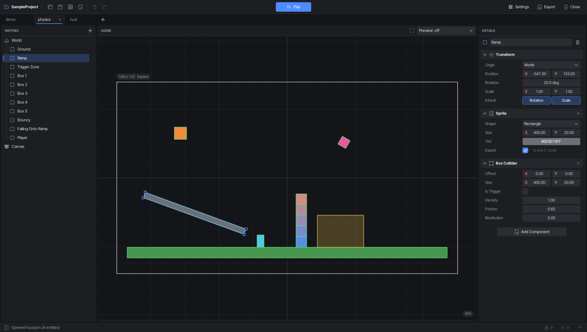
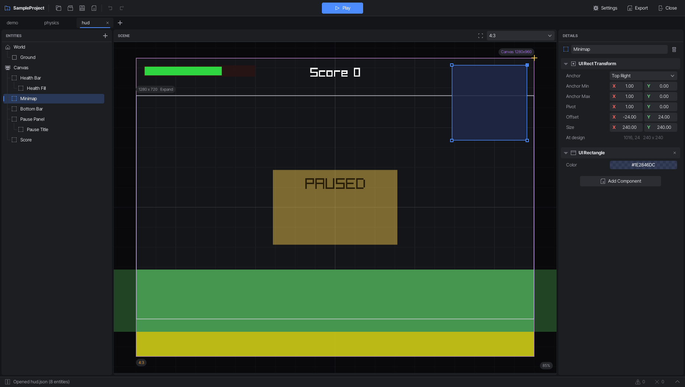
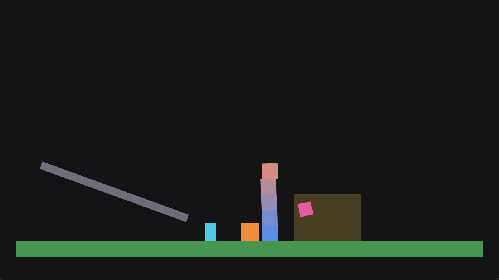

# Scene Editor

A visual scene editor for [raylib](https://www.raylib.com/) games. Lay out levels and UI
with the mouse instead of working out positions by hand, then export plain C11 that your
game builds with. Every entity and UI element becomes a named field of a C struct, so the
game reads where things are and draws its own things there, scaled to any window.



## What it does

- **Level layout:** entities with transforms and parents, sprites (rectangle, circle,
  triangle) as placeholders, and box colliders. The exported code gives you each entity's
  final `pose` and the box of each collider, ready for your own drawing or level
  generation.
- **UI that fits any screen:** UI elements anchored to the screen's corners, edges or
  centre, or stretched along them. Preview other screen shapes (16:10, 21:9, 4:3,
  portrait...) right in the editor. In the game, each element has a `rect` in window
  pixels to draw your own widgets into.
- **Scaling:** design for one resolution; the game fits it to any window with Expand,
  Fit or Fill.
- **Physics (optional):** rigidbodies and colliders become [Box2D](https://box2d.org/)
  bodies.
- **Platformer controller:** a component that makes a body a playable character: run,
  jump, coyote time, jump buffering and variable jump height, tuned in the editor.
- **Play:** export, build and run the game from the editor (F5).



## The exported game

```c
#include "scene_manager.h"

int main(void) {
    static SceneManager scenes;
    InitWindow(1280, 720, "My game");
    scene_manager_init(&scenes, SCENE_ID_LEVEL);
    while (!WindowShouldClose()) {
        scene_manager_update(&scenes, GetFrameTime());
        BeginDrawing();
        ClearBackground(BLACK);
        scene_begin(SCENE_DEFAULT_SCALE_MODE);
        scene_manager_draw(&scenes);
        DrawCircleV(scenes.level.coin.pose.position, 12.0f, GOLD); /* your own drawing, in scene coordinates */
        scene_end();
        scene_manager_draw_ui(&scenes, SCENE_DEFAULT_SCALE_MODE);
        EndDrawing();
    }
    scene_manager_deinit(&scenes);
    CloseWindow();
}
```



The guides in [docs/](docs/README.md) cover the exported code: scenes, entities, UI,
scaling, physics and the full API.

## Building the editor

The editor is C++20, built with [Meson](https://mesonbuild.com/). It needs a raylib
source checkout (raylib and raygui are built into the build folder); EnTT and
nlohmann/json come from `subprojects/`.

```bash
meson setup build -Draylib_dir=path/to/raylib
meson compile -C build
```

Then run `build/SceneEditor`.

| Command | What it does |
|---|---|
| `SceneEditor` | the editor: the last project, or the project launcher |
| `SceneEditor --open <project>` | the editor on a project (its `.sceneproj` file or folder) |
| `SceneEditor --export <project>` | export a project without opening the editor |
| `SceneEditor --version` | print the version |

**UI scale:** Ctrl+= and Ctrl+- make the editor bigger or smaller; Ctrl+0 goes back to 100%.

## License

MIT, see [LICENSE](LICENSE). Box2D (MIT) is copied into exports that use physics.
